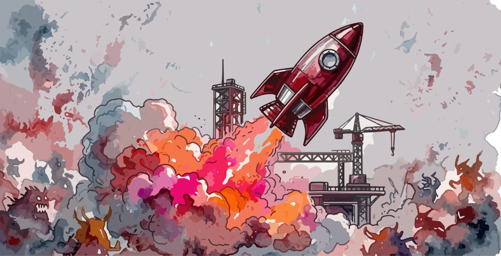
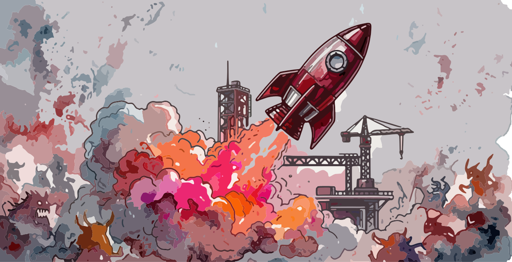

# Impulso — Manual completo do usuário

**Motor de Produtividade Pessoal — Manual integrado**  
**Aplicativo:** https://magpe-stack.github.io/Impulso/  
**Código-fonte:** https://github.com/magpe-stack/Impulso  
**Manual online:** https://github.com/magpe-stack/Impulso/blob/main/README.md

O **Impulso** é um aplicativo web progressivo (PWA) de produtividade pessoal. Nele, você cria projetos independentes, registra o tempo dedicado a trabalhos e hábitos, analisa sua constância e acompanha uma jornada de conquistas. O aplicativo combina ferramentas práticas de organização com uma linguagem visual inspirada em jogos. **O tempo registrado é real; as metáforas de propulsão, chefões e cerimônias são motivacionais.**

> **Antes de começar:** seus projetos ficam armazenados neste navegador e dispositivo, sem sincronização automática com uma conta ou nuvem. O armazenamento local e o arquivo externo são coisas diferentes: faça **backups regulares** e conserve cópias fora do navegador. A jornada de 10.000 horas é uma referência motivacional, não uma certificação de domínio profissional. O Impulso não substitui um sistema oficial de controle de jornada.

## Sumário e navegação

Selecione um título ou subtítulo para navegar.

- [1. Conheça o Impulso](#1-conheca-o-impulso)
  - [Roteiro rápido: do primeiro registro ao primeiro backup](#roteiro-rapido-do-primeiro-registro-ao-primeiro-backup)
- [2. Primeiro acesso e instalação](#2-primeiro-acesso-e-instalacao)
  - [Abrir pela primeira vez](#abrir-pela-primeira-vez)
  - [Instalar como aplicativo](#instalar-como-aplicativo)
  - [Usar offline](#usar-offline)
  - [Desinstalar](#desinstalar)
- [3. Navegação e organização do aplicativo](#3-navegacao-e-organizacao-do-aplicativo)
- [4. Projetos e Central de Comando](#4-projetos-e-central-de-comando)
  - [Criar e administrar projetos](#criar-e-administrar-projetos)
  - [Dashboard — Central de Comando](#dashboard-central-de-comando)
- [5. Ações: Ponto, Foco, Hábitos e Entradas](#5-acoes-ponto-foco-habitos-e-entradas)
  - [Ponto — registrar trabalho em andamento](#ponto-registrar-trabalho-em-andamento)
  - [Foco — sessões planejadas](#foco-sessoes-planejadas)
  - [Hábitos — prática recorrente](#habitos-pratica-recorrente)
  - [Entradas — registrar trabalho anterior](#entradas-registrar-trabalho-anterior)
  - [Como o Impulso calcula o tempo](#como-o-impulso-calcula-o-tempo)
- [6. Dados: Meu Dia, Calendário e Estatísticas](#6-dados-meu-dia-calendario-e-estatisticas)
  - [Meu Dia](#meu-dia)
  - [Calendário](#calendario)
  - [Estatísticas](#estatisticas)
  - [Armazenamento](#armazenamento)
- [7. Motor de Propulsão e metas](#7-motor-de-propulsao-e-metas)
  - [Ignição do Motor](#ignicao-do-motor)
  - [As 100 metas](#as-100-metas)
- [8. Vitórias: Arena, Codex, Elixires, Insígnias, Cerimônias e Visão](#8-vitorias-arena-codex-elixires-insignias-cerimonias-e-visao)
  - [Arena — 200 Chefões](#arena-200-chefoes)
  - [Codex — bestiário da jornada](#codex-bestiario-da-jornada)
  - [Elixires — recompensas por trabalho e hábito](#elixires-recompensas-por-trabalho-e-habito)
  - [Insígnias — títulos e medalhas](#insignias-titulos-e-medalhas)
  - [Cerimônias — marcos narrativos](#cerimonias-marcos-narrativos)
  - [Visão — acompanhar a revelação do foguete](#visao-acompanhar-a-revelacao-do-foguete)
- [9. Arquivo: guardar, atualizar, abrir e imprimir](#9-arquivo-guardar-atualizar-abrir-e-imprimir)
  - [Guardar — salvar um Backup Geral](#guardar-salvar-um-backup-geral)
  - [Atualizar — sobrescrever um backup existente](#atualizar-sobrescrever-um-backup-existente)
  - [Aviso de alterações pendentes no arquivo](#aviso-de-alteracoes-pendentes-no-arquivo)
  - [Abrir — restaurar um Backup Geral](#abrir-restaurar-um-backup-geral)
  - [Projeto individual: exportar e importar](#projeto-individual-exportar-e-importar)
  - [Abrir pelo explorador de arquivos](#abrir-pelo-explorador-de-arquivos)
  - [Imprimir e salvar em PDF](#imprimir-e-salvar-em-pdf)
- [10. Sistema: configurações, instalação e saída](#10-sistema-configuracoes-instalacao-e-saida)
  - [Fechar o Impulso com um arquivo pendente](#fechar-o-impulso-com-um-arquivo-pendente)
- [11. Atalhos de teclado e de aplicativo](#11-atalhos-de-teclado-e-de-aplicativo)
  - [Atalhos de teclado](#atalhos-de-teclado)
  - [Atalhos do aplicativo](#atalhos-do-aplicativo)
- [12. Impulsinho — assistente emocional e motivacional](#12-impulsinho-assistente-emocional-e-motivacional)
  - [Personagem e balões](#personagem-e-baloes)
  - [Consultas e navegação contextual](#consultas-e-navegacao-contextual)
  - [Oráculo — consulta ao Manual](#oraculo-consulta-ao-manual)
  - [Tutorial e reações às ações](#tutorial-e-reacoes-as-acoes)
  - [Expressões e bibliotecas de falas](#expressoes-e-bibliotecas-de-falas)
  - [Frases motivacionais](#frases-motivacionais)
  - [Personalidades](#personalidades)
  - [Evolução por projeto](#evolucao-por-projeto)
  - [Sons e vinheta de abertura](#sons-e-vinheta-de-abertura)
  - [Controles e acessibilidade](#controles-e-acessibilidade)
- [13. Alertas, distintivos e área de transferência](#13-alertas-distintivos-e-area-de-transferencia)
  - [Alertas locais](#alertas-locais)
  - [Central de novidades e distintivos — Badging API](#central-de-novidades-e-distintivos-badging-api)
  - [Copiar resumos — Clipboard API](#copiar-resumos-clipboard-api)
- [14. Armazenamento e limpeza](#14-armazenamento-e-limpeza)
  - [Onde ficam os dados](#onde-ficam-os-dados)
  - [Limpeza seletiva](#limpeza-seletiva)
  - [Antes de limpar](#antes-de-limpar)
- [15. Temas, acessibilidade e privacidade](#15-temas-acessibilidade-e-privacidade)
  - [As sete identidades cromáticas](#as-sete-identidades-cromaticas)
  - [Acessibilidade](#acessibilidade)
  - [Privacidade](#privacidade)
- [16. Solução de problemas](#16-solucao-de-problemas)
- [17. Perguntas frequentes](#17-perguntas-frequentes)
- [18. Verificação de funcionamento](#18-verificacao-de-funcionamento)
- [19. Estrutura do projeto e glossário](#19-estrutura-do-projeto-e-glossario)
  - [Arquivos principais](#arquivos-principais)
  - [Glossário](#glossario)

---

## 1. Conheça o Impulso

O Impulso ajuda a transformar esforço disperso em um histórico consultável. Você pode registrar trabalhos, organizar sessões de concentração, praticar hábitos, consultar dias anteriores, acompanhar metas e visualizar conquistas. Tudo é separado por **projeto**, para que uma atividade não se misture às demais.

O aplicativo combina cinco dimensões:

- **Registro:** tempo de trabalho por Ponto, Foco, Hábitos e Entradas manuais.
- **Organização:** projetos independentes, calendário e consulta diária.
- **Análise:** Dashboard, estatísticas e acompanhamento de sequências.
- **Progressão:** Motor de Propulsão, 100 metas, Arena e conquistas.
- **Autonomia:** funcionamento offline após o cache inicial, backups locais, importação e controles de manutenção.

A proposta não é vigiar o usuário, mas ajudá-lo a perceber a continuidade de seus próprios esforços. Um projeto pode ser um livro, uma formação, um empreendimento, uma pesquisa ou qualquer objetivo que demande dedicação consistente.

### Roteiro rápido: do primeiro registro ao primeiro backup

1. Abra o aplicativo e escolha **Arquivo → Novo**. Dê um nome ao seu projeto.
2. Vá a **Ações → Ponto**, informe o nome de uma tarefa e inicie o registro.
3. Ao terminar, volte a **Ponto** e conclua a atividade.
4. Consulte **Dados → Meu Dia** para conferir horários e duração.
5. Acompanhe o progresso em **Dados → Dashboard** e **Dados → Motor**.
6. Escolha **Arquivo → Guardar** e salve uma cópia de segurança.

**Dica:** não é necessário conhecer a Arena ou as Cerimônias para começar. Elas acompanham naturalmente o tempo que você registra.

[↑ Voltar ao sumário](#sumario-e-navegacao)

---

## 2. Primeiro acesso e instalação

### Abrir pela primeira vez

1. Acesse **https://magpe-stack.github.io/Impulso/** com conexão à internet.
2. Aguarde a abertura **Ignição**, com o foguete, o anel luminoso e a revelação do nome.
3. Na Central de Comando, escolha **Novo** para criar um projeto ou **Projetos** para abrir um já existente.
4. Comece a registrar atividades. Quando houver dados importantes, use **Arquivo → Guardar** para produzir um backup.

A abertura Ignição é uma apresentação visual, não um indicador real da velocidade de carregamento. Os efeitos podem ser simplificados quando o sistema solicita redução de movimento.

### Instalar como aplicativo

Abra **Sistema → Instalar**. Quando o navegador disponibilizar `beforeinstallprompt`, o Impulso pode mostrar um convite com a identidade visual do aplicativo e encaminhar o pedido à confirmação **nativa** do navegador. A instalação depende da plataforma: o Impulso não instala a si mesmo.

O convite oferece **Instalar**, **Agora não** (adiamento de novos convites automáticos por 14 dias) e **Não mostrar novamente**. A recusa não impede o uso pelo navegador; o comando manual continua disponível. Se a instalação programática não estiver disponível, siga as instruções apresentadas para o navegador e o dispositivo.

No Windows, Chrome e Edge podem permitir a instalação como aplicativo. No Android, use a opção de instalação ou adição à tela inicial oferecida pelo navegador. A apresentação varia entre plataformas.

### Usar offline

O **Service Worker** armazena os arquivos essenciais do PWA para permitir novas aberturas sem internet, depois que o cache tiver sido preenchido. Registros e consultas locais também podem funcionar offline. A disponibilidade depende das políticas de armazenamento do navegador; **offline não significa backup**.

### Desinstalar

Em **Sistema → Desinstalar**, consulte as orientações para remover o PWA pelo navegador ou sistema operacional. Uma página web não pode desinstalar a si mesma. Antes de remover o aplicativo ou apagar seus dados, **guarde um backup**.

[↑ Voltar ao sumário](#sumario-e-navegacao)

---

## 3. Navegação e organização do aplicativo

O menu lateral é organizado em seis grupos recolhíveis:

| Grupo | Comandos |
| --- | --- |
| **Arquivo** | Novo · Projetos · Guardar · Atualizar · Abrir · Imprimir |
| **Ações** | Ponto · Foco · Hábitos · Entradas |
| **Vitórias** | Arena · Codex · Elixires · Insígnias · Cerimônias · Visão |
| **Dados** | Dashboard · Meu Dia · Calendário · Motor · Estatísticas · Armazenamento |
| **Sistema** | Configurações · Instalar · Desinstalar · Fechar |
| **Ajuda** | GitHub · Manual · Sobre |

Clique ou toque no nome de um grupo para expandi-lo ou recolhê-lo. O menu pode ser fechado pelo botão correspondente, pelo fundo externo ou pela tecla **Esc** quando aplicável. Os atalhos no Dashboard oferecem acesso às operações mais frequentes.

**Ajuda → GitHub** abre o repositório oficial; **Ajuda → Manual** abre este documento online; **Ajuda → Sobre** apresenta a ficha explicativa do aplicativo, também acessível pelo rodapé.

O rodapé acompanha as cores do tema selecionado e permanece no fim da janela nas páginas curtas. Nas páginas longas, aparece depois do conteúdo. O **Dashboard** é uma exceção deliberada: foi desenhado como uma Central de Comando de tela única, sem rodapé.

[↑ Voltar ao sumário](#sumario-e-navegacao)

---

## 4. Projetos e Central de Comando

### Criar e administrar projetos

Escolha **Arquivo → Novo**, informe um nome e confirme. Em **Arquivo → Projetos**, abra outro projeto, altere seu nome ou exclua um projeto quando necessário. A exclusão exige confirmação e pode apagar definitivamente seus registros, hábitos e conquistas; exporte um backup antes.

Cada projeto possui seus próprios registros, hábitos, metas, chefões, Elixires e Insígnias. O aplicativo mantém um **projeto ativo**, utilizado pelas ferramentas de registro. Alternar entre projetos não transfere automaticamente o tempo de um para outro.

### Dashboard — Central de Comando

O Dashboard é a página inicial do Impulso. Ele reúne:

- **Tempo total** registrado no projeto e **tempo de hoje**.
- **Sequência de produtividade**, em dias.
- **Giros** acumulados, **progresso da Propulsão** e **metas concluídas**.
- **Mapa de Atividade** dos últimos 365 dias, com quadradinhos que representam dias e intensidade relacionada ao tempo registrado.
- **Atividade em andamento**, quando houver, e **próxima meta** com barra de progresso.
- **Título atual** e **medalha recente**, com acesso à página Insígnias.
- Oito atalhos internos: **Ponto, Foco, Hábitos, Entradas, Projetos, Novo, Calendário e Configurações**.

Os indicadores usam os registros reais do projeto. Intervalos simultâneos não devem ser somados duas vezes no total produtivo. O botão **Copiar resumo** permite levar os principais números para a área de transferência.

[↑ Voltar ao sumário](#sumario-e-navegacao)

---

## 5. Ações: Ponto, Foco, Hábitos e Entradas

### Ponto — registrar trabalho em andamento

Em **Ações → Ponto**, informe o nome do trabalho e utilize os controles de início e término da atividade. O formulário fica na própria página, permitindo navegar por outras áreas enquanto o trabalho continua sendo contabilizado. Ao concluir, o registro passa a integrar as consultas diárias e estatísticas.

- O nome da atividade aceita até **50 caracteres**.
- O tempo é calculado a partir dos horários reais de início e término, não pela quantidade de atualizações visuais da tela.
- Uma atividade pode atravessar a meia-noite; o tempo é atribuído aos dias correspondentes.
- Antes de encerrar ou apagar dados, confira se há uma atividade ativa.

### Foco — sessões planejadas

Em **Ações → Foco**, configure uma atividade de até **50 caracteres**, um objetivo de até **200 caracteres**, o tipo de compromisso (**Entrega** ou **Dedicação**) e a duração planejada, de **1 a 1.440 minutos**. Inicie a sessão e, quando necessário, utilize **Pausar** e **Retomar**.

Ao concluir, avalie o resultado como **alcançado integralmente**, **parcialmente** ou **não alcançado**. Uma observação opcional de até **200 caracteres** permite registrar o aprendizado. As pausas são excluídas do tempo efetivo. A sessão pertence ao projeto ativo e é considerada nos indicadores correspondentes.

### Hábitos — prática recorrente

Em **Ações → Hábitos**, escolha hábitos do catálogo ou crie hábitos personalizados. Os hábitos podem ter uma duração configurada e ser executados por temporizador. A conclusão gera um registro com o nome do hábito e os horários correspondentes.

O aplicativo permite manter até **seis hábitos equipados** simultaneamente. O catálogo possui categorias e pesquisa; hábitos personalizados podem ser equipados ou retirados do conjunto ativo. Para evitar inconsistências, conclua ou reinicie um temporizador antes de alterar a condição de um hábito em execução.

A área de Hábitos também se relaciona com o sistema de Elixires: concluir um hábito pode abrir um cofre de Chefão previamente derrotado, de acordo com as regras da coleção.

### Entradas — registrar trabalho anterior

Em **Ações → Entradas**, informe a data, o nome da atividade, o horário de início e o horário de término. O formulário valida a ordem dos horários e permite atividades que terminam em outro dia. Utilize essa função quando o trabalho já tiver ocorrido e não tiver sido registrado pelo temporizador.

Entradas retroativas contribuem para o histórico, o Motor e as estatísticas conforme o tempo efetivamente registrado. Evite lançar novamente um intervalo que já exista, para não criar registros redundantes.

### Como o Impulso calcula o tempo

O aplicativo trabalha com intervalos de tempo. Ao somar a produtividade, **une intervalos sobrepostos** dentro do mesmo projeto, evitando contagem dupla. Para a apresentação diária, divide intervalos que atravessam a meia-noite. Por exemplo, uma atividade das 23h às 1h distribui uma hora para cada dia.

O tempo registrado não deve ser confundido com qualidade, resultado profissional ou presença formal no trabalho.

[↑ Voltar ao sumário](#sumario-e-navegacao)

---

## 6. Dados: Meu Dia, Calendário e Estatísticas

### Meu Dia

Em **Dados → Meu Dia**, consulte as atividades do dia, com nome, tipo, horários de início e término e duração. O título identifica a data no formato **dd-mm-aaaa**, por exemplo **Meu Dia 10-09-2027**. Hábitos concluídos e atividades de Ponto, Foco ou Entradas aparecem conforme os registros existentes. Utilize os controles de exclusão com atenção: apagar um registro pode modificar totais e conquistas.

O comando **Copiar resumo** gera texto com os registros e totais disponíveis, sem alterar os dados.

### Calendário

Em **Dados → Calendário**, navegue entre meses e selecione datas para consultar a produtividade. A visualização ajuda a identificar dias ativos, lacunas e distribuição do trabalho. O calendário utiliza as datas locais dos registros; uma sessão que atravessa a meia-noite pode contribuir para dois dias.

### Estatísticas

Em **Dados → Estatísticas**, escolha o **alcance** da análise (projeto ativo ou conjunto de projetos, quando disponível) e o **período**: hoje, últimos sete dias, mês atual, ano atual ou todo o histórico. A página apresenta medidas como tempo produtivo, dias ativos, médias, quantidade de sessões, maior intervalo contínuo e frequência de atividade, além de indicadores complementares de progresso.

Use **Atualizar** para recalcular a apresentação, **Exportar** para obter os dados disponibilizados e **Imprimir** para gerar um documento pelo navegador. **Copiar resumo** respeita os filtros selecionados.

A média por dia ativo é diferente da média por dia do período: a primeira considera apenas os dias com atividade; a segunda considera todos os dias do intervalo escolhido. Registros simultâneos são tratados para não duplicar o tempo produtivo.

### Armazenamento

Em **Dados → Armazenamento**, acompanhe informações sobre os dados locais e, quando disponível, solicite armazenamento persistente ao navegador. O navegador pode negar a solicitação; persistência reduz alguns riscos de remoção automática, mas **não substitui um backup**.

[↑ Voltar ao sumário](#sumario-e-navegacao)

---

## 7. Motor de Propulsão e metas

O **Motor** transforma tempo produtivo em uma linguagem simbólica de movimento. Cada **10 segundos equivalem a 1 grau**. O rotor e os indicadores representam progresso acumulado; não são uma simulação física de motor nem produzem tempo adicional.

| Unidade | Equivalência | Graus | Tempo |
| --- | --- | ---: | --- |
| **Pulso** | 180 graus | 180 | 30 minutos |
| **Giro** | 2 Pulsos | 360 | 1 hora |
| **Turno** | 8 Giros | 2.880 | 8 horas |
| **Fase** | 30 Turnos | 86.400 | 240 horas |
| **Propulsão** | 42 Fases | 3.628.800 | 10.080 horas |

Os contadores de unidades são diferentes maneiras de representar o mesmo tempo: **não devem ser somados entre si**. Por exemplo, 8 horas correspondem a 16 Pulsos, 8 Giros ou 1 Turno.

### Ignição do Motor

O botão **Ignição** reproduz visualmente a rotação correspondente aos graus acumulados. **Parar** interrompe a animação; reiniciá-la não acrescenta horas, Giros ou recompensas. Em sistemas com preferência por movimento reduzido, a representação pode ser simplificada. O Motor também exibe indicadores de rotação e tempo em escalas de 360 graus e 60 segundos.

### As 100 metas

A jornada simbólica possui **100 metas progressivas**, culminando em **10.000 horas**. O total necessário para a meta de número *n* é **n² horas**: a primeira exige 1 hora acumulada; a segunda, 4; a terceira, 9; e a centésima, 10.000. Cada etapa exige mais horas adicionais que a anterior.

A **primeira Propulsão completa**, com 10.080 horas, é um marco próprio do Motor, posterior à centésima meta. A referência de 10.000 horas não certifica competência nem garante resultados.

[↑ Voltar ao sumário](#sumario-e-navegacao)

---

## 8. Vitórias: Arena, Codex, Elixires, Insígnias, Cerimônias e Visão

### Arena — 200 Chefões

A **Arena** transforma a trajetória de 10.000 horas em **200 batalhas progressivas**. Os Chefões representam obstáculos simbólicos à constância. O avanço é calculado a partir do tempo produtivo registrado, com resistência crescente. Não existe botão para declarar uma vitória sem cumprir o tempo exigido. Excluir registros pode alterar a situação das batalhas.

### Codex — bestiário da jornada

O **Codex** apresenta os Chefões, seus nomes, descrições e informações associadas. É uma área de consulta narrativa: ajuda a dar significado à progressão, mas não altera os registros de tempo.

### Elixires — recompensas por trabalho e hábito

Existem **200 Elixires colecionáveis**, vinculados aos Chefões. O processo tem duas condições:

1. Acumular trabalho suficiente para **derrotar um Chefão**.
2. **Concluir um hábito depois da vitória**, abrindo um cofre elegível.

Cada hábito concluído libera **no máximo um Elixir**; vencer um Chefão não abre automaticamente seu cofre. Conclusões anteriores à vitória não são reaproveitadas para cofres futuros. Se o registro que sustentava a recompensa for excluído, ela pode ser revogada. As frases dos Elixires podem ser copiadas ou compartilhadas quando o navegador permitir.

**Não confunda:** os hábitos equipados, por vezes chamados de Elixires Ativos, não são as mesmas coisas que os Elixires colecionáveis.

### Insígnias — títulos e medalhas

Cada projeto pode conquistar **50 títulos automáticos** relacionados à evolução e **60 medalhas permanentes**, distribuídas entre produtividade, regularidade, hábitos e Chefões. O título atual é atribuído automaticamente: não há necessidade de equipá-lo manualmente. A coleção distingue itens desbloqueados e bloqueados. O Dashboard apresenta o título atual e a medalha mais recente.

O botão **Copiar resumo** permite copiar as conquistas registradas. A coleção é individual por projeto.

### Cerimônias — marcos narrativos

Existem **100 Cerimônias**, correspondentes às metas da jornada. Elas são liberadas pelo tempo acumulado; marcos de dez em dez metas recebem apresentações especiais, culminando na **Consagração**. Na galeria, escolha uma cerimônia disponível para abrir sua apresentação e, quando oferecido, reproduzi-la novamente. Cerimônias bloqueadas indicam o requisito de horas.

A apresentação é visual e não concede tempo ou recompensas extras. A disponibilidade depende do progresso real; se registros forem excluídos, uma cerimônia poderá voltar a ficar bloqueada. O usuário pode fechar a apresentação; preferências de movimento reduzido devem ser respeitadas.

### Visão — acompanhar a revelação do foguete

A página **Visão** apresenta uma composição visual relacionada aos Elixires conquistados. À medida que a coleção evolui, partes da imagem do foguete são reveladas. É um recurso de acompanhamento simbólico, não um cálculo adicional de produtividade.

[↑ Voltar ao sumário](#sumario-e-navegacao)

---

## 9. Arquivo: guardar, atualizar, abrir e imprimir

**Avisos pelo Impulsinho:** as pendências do arquivo externo podem ser consultadas pelo personagem. Quando o Backup Geral precisar ser atualizado, toque no Impulsinho e selecione **Atualizar Backup Geral**. A confirmação de sobrescrita e a proteção de saída continuam ativas. A opção **Conquistas** resume novidades; a leitura individual ocorre na Central de Novidades.

**O armazenamento principal do Impulso continua sendo local, no navegador.** Os arquivos JSON são cópias para segurança e transferência; não substituem automaticamente o estado salvo enquanto você trabalha.

### Guardar — salvar um Backup Geral

Abra **Arquivo → Guardar**. Em navegadores compatíveis com a **File System Access API**, escolha o nome e o destino do arquivo. Nos demais, o navegador utiliza o download convencional. Confira se o arquivo foi efetivamente salvo e mantenha uma cópia fora do dispositivo.

O **Backup Geral contém todos os projetos existentes no Impulso no momento da gravação**, e não somente o projeto aberto. Por exemplo: se você guardou o arquivo quando existia apenas o Projeto A e depois criou o Projeto B, a próxima atualização do Backup Geral incluirá **A e B**. Se um projeto foi excluído do aplicativo, ele poderá deixar de constar na versão atualizada do backup.

A função não envia dados para uma nuvem e não garante, por si só, que o arquivo tenha sido copiado para outro local.

### Atualizar — sobrescrever um backup existente

Em **Arquivo → Atualizar**, selecione um arquivo de Backup Geral existente ou utilize o arquivo selecionado na sessão, quando aplicável. O Impulso verifica se ele é compatível e **solicita confirmação antes de sobrescrevê-lo** com os dados atuais. A operação depende do suporte do navegador à gravação direta. Se não houver suporte, utilize **Guardar** para gerar um novo arquivo.

**Atenção à sobrescrita:** Atualizar substitui o conteúdo anterior do arquivo escolhido pelo **estado atual de todos os projetos**. Não significa que o projeto recém-criado apagará os demais; significa que o backup anterior será substituído por um novo retrato do conjunto. Verifique o destino e mantenha pelo menos uma cópia anterior de segurança.

### Aviso de alterações pendentes no arquivo

O Impulso guarda seus registros localmente durante o uso. O estado do arquivo externo é acompanhado separadamente. Quando houver alterações pendentes, consulte o Impulsinho e utilize **Atualizar Backup Geral**, ou acesse **Arquivo → Atualizar**. Se ainda não houver arquivo escolhido, utilize **Guardar**.

Confirme o destino e aguarde a gravação. Em navegadores que apenas iniciam um download, o aplicativo não consegue confirmar que o arquivo foi efetivamente guardado. A associação ao arquivo pode precisar ser refeita após reiniciar o navegador.

O aviso de backup não é o contador de conquistas do cabeçalho. Desativar alertas não atualiza o arquivo externo.

### Abrir — restaurar um Backup Geral

Em **Arquivo → Abrir**, escolha o arquivo e leia a confirmação. **A restauração geral substitui os projetos atuais** pelos contidos no backup. Faça um backup do estado atual antes de confirmar. O arquivo é validado, mas ainda é necessário conferir os dados depois da restauração.

### Projeto individual: exportar e importar

O **Backup Geral** reúne todos os projetos; um arquivo de **projeto individual** contém somente o projeto escolhido. Se o aplicativo oferecer controles de exportação ou importação individual na área de projetos, use-os para transportar apenas esse projeto. Antes de importar, confira o tipo do arquivo e leia a confirmação apresentada. **Não utilize a restauração geral para importar um único projeto.**

### Abrir pelo explorador de arquivos

Em versões compatíveis do Chrome e Edge para desktop, o PWA instalado pode receber arquivos `.json` e `.impulso` por meio da **File Handling API**. O sistema pode oferecer **Abrir com → Impulso**. O aplicativo identifica se o arquivo contém um projeto individual ou um Backup Geral e encaminha para o fluxo apropriado, sempre com confirmação. A associação não é universal e pode exigir reinstalar o PWA após mudanças no manifesto.

No Android e em navegadores sem suporte, use os seletores de arquivos dentro do Impulso.

### Imprimir e salvar em PDF

Em **Arquivo → Imprimir**, prepare o relatório disponibilizado pelo aplicativo. Na janela de impressão do navegador, escolha uma impressora ou **Salvar como PDF**, quando disponível. Revise datas, nomes e totais antes de compartilhar. Os relatórios não são sincronizados automaticamente com serviços externos.

[↑ Voltar ao sumário](#sumario-e-navegacao)

---

## 10. Sistema: configurações, instalação e saída

Acesse **Sistema → Configurações**. A página contém **cinco seções recolhíveis**, para facilitar a navegação:

1. **Temas:** identidade cromática e modo claro/escuro.
2. **Atalhos de Teclado:** combinações, chaves individuais e redefinição.
3. **Atalhos do Aplicativo:** chaves para acessos rápidos internos.
4. **Controles do Impulsinho:** comportamento, personalidade, expressões, áudio, tutorial, alertas e distintivos.
5. **Limpeza:** manutenção seletiva ou completa dos dados identificados como pertencentes ao Impulso.

Clique no título de uma seção para abri-la ou recolhê-la. A página permite concentrar as preferências sem multiplicar telas no menu.

**Sistema → Instalar** e **Sistema → Desinstalar** são explicados no capítulo 2. **Sistema → Fechar** solicita confirmação e apresenta a saída do aplicativo; o navegador pode impedir que uma página feche a própria janela. Nesse caso, feche a aba ou janela manualmente. Os dados já salvos permanecem no armazenamento local, a menos que sejam removidos por outra operação.

### Fechar o Impulso com um arquivo pendente

Ao escolher **Sistema → Fechar**, se o Backup Geral estiver desatualizado, o aplicativo oferece **Cancelar**, **Fechar sem atualizar** ou **Atualizar arquivo**. A gravação não encerra automaticamente uma sessão de trabalho em andamento.

Se você clicar no **X da janela**, fechar a aba ou recarregar a página, o navegador **poderá** exibir sua confirmação nativa de saída. Esse aviso não é garantido em todas as plataformas; o Impulso não controla seu texto nem consegue aguardar uma gravação assíncrona durante o fechamento.

Para evitar surpresas, confira as pendências do backup e atualize seu backup **antes** de fechar o aplicativo.

[↑ Voltar ao sumário](#sumario-e-navegacao)

---

## 11. Atalhos de teclado e de aplicativo

### Atalhos de teclado

Em **Configurações → Atalhos de Teclado**, ative ou desative os comandos globalmente ou de forma individual. Cada atalho possui um comando para **alterar a combinação de teclas** e outro para **restaurar o padrão**. O aplicativo verifica conflitos entre combinações cadastradas.

Os comandos disponíveis incluem **Novo Projeto, Projetos, Ponto, Foco, Hábitos, Entradas, Dashboard, Meu Dia, Calendário, Motor, Estatísticas, Insígnias e Configurações**. A página apresenta as combinações atualmente configuradas; consulte-a em vez de presumir que uma tecla ainda usa o padrão.

Os atalhos só atuam quando o Impulso está aberto e recebe eventos do teclado. Não devem interromper a digitação em campos de formulário. Algumas combinações podem ser reservadas pelo sistema operacional, pelo idioma do teclado ou pelo navegador; nesses casos, escolha outra combinação.

### Atalhos do aplicativo

Em **Configurações → Atalhos do Aplicativo**, configure as chaves dos **13 acessos rápidos internos**. Os mesmos destinos são declarados no manifesto para sistemas que oferecem **App Shortcuts** ao pressionar o ícone instalado.

**Limitação:** o sistema operacional decide quais atalhos do manifesto exibir. As chaves internas não conseguem remover individualmente entradas do menu de contexto do sistema. Nenhum atalho deve iniciar um temporizador ou modificar dados sem uma ação posterior do usuário.

[↑ Voltar ao sumário](#sumario-e-navegacao)

---

## 12. Impulsinho — assistente emocional e motivacional

O Impulsinho acompanha o projeto ativo com comentários, orientações, expressões e efeitos sonoros. Ele funciona localmente, sem IA generativa, sem enviar perguntas a servidores e sem inventar estatísticas. Seu repertório é composto por regras, eventos e textos preparados.

### Personagem e balões

Arraste o personagem para reposicioná-lo. Toque nele para abrir ou fechar seu balão de fala. O botão **☰** abre um painel separado de perguntas e comandos. As respostas aparecem no balão do personagem. Use Ajustes para acessar as preferências e, se ocultar o avatar, utilize Mostrar Impulsinho para recuperá-lo.

### Consultas e navegação contextual

Expanda **Perguntas rápidas** ou digite uma pergunta de até 180 caracteres. Experimente “Quanto tempo trabalhei hoje?”, “Como está meu Motor?”, “Quantos chefões derrotei?” ou “Qual é seu estágio?”. Os temas reconhecidos incluem Meu Dia, Motor, Arena, Hábitos, Elixires, Conquistas, Estatísticas, Projetos, Ponto, Foco, Calendário, Dashboard, Backup e Configurações. Quando aplicável, o assistente abre a página correspondente e comenta os dados disponíveis. Navegar não inicia nem encerra atividades. Perguntas não reconhecidas recebem orientação sobre o repertório disponível.

A consulta Conquistas resume até cinco novidades pendentes; use a Central de Novidades para consultar cada item. O comando Atualizar Backup Geral encaminha ao fluxo de gravação, sem dispensar confirmações.

### Oráculo — consulta ao Manual

No painel ☰ do Impulsinho, digite uma pergunta sobre o funcionamento do aplicativo, como “Como restaurar um backup?” ou “Qual a diferença entre Guardar e Atualizar?”. O Oráculo pesquisa o próprio Manual armazenado localmente, considerando palavras-chave, sinônimos e pequenos erros de digitação. A resposta apresenta trechos documentais e identifica a seção consultada. Perguntas complementares curtas podem aproveitar o assunto anterior. Consultas de progresso e comandos explícitos continuam usando os mecanismos existentes. A pesquisa não altera projetos nem executa operações de arquivo. Se não encontrar correspondência suficiente, o assistente pede uma reformulação. Não se trata de IA generativa; a seleção de trechos pode ser imperfeita. O Manual é atualizado junto com os recursos do aplicativo e fica disponível offline após o cache inicial.

### Tutorial e reações às ações

Sem projeto ativo, o passeio inicial pode apresentar três orientações sobre menu, criação de projeto e registro de atividades. O passeio automático depende das preferências e do histórico local. O botão **Tutorial** permite repetir a orientação; com projeto ativo, apresenta um resumo dos primeiros passos. O movimento respeita a preferência de redução de animações.

Os controles do aplicativo podem provocar comentários, expressões e sons, sujeitos a intervalos e preferências. Na Ignição do Motor, o personagem considera Giros, sequência atual, recorde e tempo desde o último registro. Uma pausa não é tratada como falha pessoal. Reações gerais não significam que cada operação foi concluída com sucesso.

### Expressões e bibliotecas de falas

O catálogo reúne 109 facetas WebP, agrupadas em alegria, curiosidade, surpresa, desafio, preocupação, descanso, humor e cuidado. Explore as expressões nas configurações, avance ou volte no catálogo, escolha uma família ou ative a alternância automática. Há quatro comentários associados a cada faceta e 1.200 variações contextuais em doze temas. Os números apresentados nas consultas vêm dos registros, não dos textos preparados.

### Frases motivacionais

A biblioteca adicional contém 1.000 frases em sete categorias: hábitos, uso do tempo, estoicismo, motivação, positividade, foco e disciplina, crescimento e mentalidade. O comando **Uma frase** solicita uma mensagem. Intervenções ocasionais priorizam o contexto da página e evitam repetir os últimos 80 identificadores, quando há alternativas. A seleção automática respeita o modo de conversa e evita interromper a digitação ou sessões de trabalho. As frases são reflexões, não diagnósticos nem garantias de resultados.

### Personalidades

| Personalidade | Comportamento |
| --- | --- |
| Divertido | Tom descontraído, humor e intervenções mais frequentes. |
| Mentor | Orientação equilibrada e reflexiva; perfil padrão. |
| Guerreiro | Linguagem de desafio, energia e incentivo às conquistas. |
| Discreto | Menos intervenções e efeitos mais suaves. |

Escolha o perfil em Sistema → Configurações → Controles do Impulsinho. A personalidade modifica o tom, a frequência e a intensidade sonora, não as regras de produtividade.

### Evolução por projeto

A experiência é calculada com os registros atuais: um ponto por Giro completo, cinco por chefão derrotado, um por hábito concluído e dois por dia da sequência recorde.

| Estágio | XP mínimo |
| --- | ---: |
| Aprendiz | 0 |
| Companheiro | 25 |
| Estrategista | 100 |
| Mestre | 500 |
| Guardião do Impulso | 2.000 |

Use **Minha evolução** para consultar estágio, XP e distância até o próximo patamar. O personagem pode anunciar avanços e oferecer conselhos do estágio. A exclusão de registros pode reduzir a experiência. A evolução é independente da personalidade e não modifica a Arena.

### Sons e vinheta de abertura

Os efeitos são sintetizados por famílias emocionais pela Web Audio API. Ajuste o volume, silencie ou desative os sons nas configurações. Use **Testar som do Impulsinho** para autorizar e verificar a reprodução. A vinheta do splash apresenta nove notas ascendentes e tem opção independente de ativação e botão **Testar vinheta**. Navegadores podem bloquear áudio automático antes de uma interação; o aplicativo deve abrir mesmo sem som. Comece com volume moderado.

### Controles e acessibilidade

Em Sistema → Configurações → Controles do Impulsinho, escolha o modo Espontaneamente, Somente quando eu clicar ou Ambos. O modo por clique evita abertura espontânea dos balões; o modo Ambos admite avisos ativados e ações importantes. Ajuste visibilidade, flutuação, alternância de expressões, personalidade, áudio, volume, tutorial, vinheta, alertas de backup e Elixires e distintivos. Os distintivos não dependem da visibilidade do avatar. Os alertas desativados não devem gerar intervenções espontâneas correspondentes. Os balões possuem foco visível, mensagens anunciáveis por leitores de tela e alvos de toque ampliados.

[↑ Voltar ao sumário](#sumario-e-navegacao)

---

## 13. Alertas, distintivos e área de transferência

Os controles de alertas de backup, hábitos e Elixires e distintivos estão reunidos em **Sistema → Configurações → Controles do Impulsinho**. Os distintivos não dependem da visibilidade do personagem. Alertas desativados são retirados também da fila de intervenções do assistente.

### Alertas locais

Em **Configurações → Controles do Impulsinho**, ative ou desative os lembretes disponíveis, como avisos relacionados a backups e hábitos. Eles são **avisos locais enquanto o aplicativo executa**: não são notificações push garantidas com o PWA fechado, nem realizam backups automaticamente.

### Central de novidades e distintivos — Badging API

A opção **Distintivos de conquistas** solicita ao sistema operacional, quando compatível, a apresentação de um contador no ícone do PWA instalado. O número representa **novidades ainda não consultadas**, como títulos, medalhas, Chefões, Cerimônias e Elixires.

O Impulso também apresenta um **contador interno no cabeçalho**. No computador, passe o mouse sobre ele ou clique; no celular, toque no contador. Abre-se a **Central de Novidades**, que apresenta individualmente títulos, medalhas, Chefões, Cerimônias e Elixires, incluindo o projeto de origem.

Selecione uma novidade para visitar a seção correspondente e registrá-la como consultada. **Abrir a lista, por si só, não elimina as demais novidades.** A leitura é individual, e o estado consultado é mantido localmente por projeto. A lista também pode ser utilizada por teclado; **Esc** a fecha.

As conquistas existentes antes da ativação inicial não devem aparecer como novidades artificiais. A Badging API não é uma notificação push e não garante atualização enquanto o aplicativo estiver fechado.

### Copiar resumos — Clipboard API

O comando **Copiar resumo** aparece em **Dashboard, Meu Dia, Estatísticas e Insígnias**. Ele copia texto com os dados reais disponíveis; em Estatísticas, respeita os filtros ativos. A cópia não modifica registros e pode ser colada em documentos, mensagens e editores. A disponibilidade depende das permissões e do suporte do navegador.

Elixires também podem oferecer ações de copiar e compartilhar. A cópia de resumos **não gera imagens nem arquivos**.

[↑ Voltar ao sumário](#sumario-e-navegacao)

---

## 14. Armazenamento e limpeza

### Onde ficam os dados

Os projetos são mantidos no armazenamento local do navegador, associados à origem e ao contexto do aplicativo. Isso não equivale a um banco de dados em nuvem. Apagar os dados do site, usar outro perfil de navegador ou trocar de dispositivo pode fazer os projetos desaparecerem naquele ambiente.

### Limpeza seletiva

Em **Configurações → Limpeza**, escolha os componentes que deseja remover:

| Componente | Consequência |
| --- | --- |
| **Projetos e registros** | Remove projetos, atividades, hábitos e conquistas locais. |
| **Preferências e alertas** | Redefine temas, atalhos, avisos e preferências relacionadas. |
| **Cache offline** | Remove os caches identificados como pertencentes ao Impulso; o navegador poderá recriá-los. |
| **Service Worker** | Cancela o registro do Service Worker no escopo do aplicativo; o funcionamento offline poderá ser afetado até novo registro. |

Use **Limpar selecionados** para executar apenas as opções marcadas. **Limpar tudo do Impulso** solicita a remoção das quatro categorias. As operações exigem confirmação; a exclusão de projetos também exige digitar **APAGAR**.

**Atenção:** o domínio GitHub Pages pode hospedar outros aplicativos. A limpeza foi projetada para atuar sobre chaves, caches e registro identificados como pertencentes ao Impulso, **não como uma limpeza indiscriminada de todos os dados do domínio**. Não apaga arquivos JSON já baixados nem garante remover bancos desconhecidos de outros aplicativos.

### Antes de limpar

1. Faça **Arquivo → Guardar**.
2. Confira se o arquivo existe e está íntegro.
3. Guarde outra cópia em local seguro.
4. Confirme se realmente deseja excluir dados ou apenas atualizar o cache.

[↑ Voltar ao sumário](#sumario-e-navegacao)

---

## 15. Temas, acessibilidade e privacidade

### As sete identidades cromáticas

O Impulso oferece **Original, Vinho, Blue Sky, Triádico, Granfino, Ecológico e Místico**, cada uma com modo **claro** e **escuro**. As paletas oficiais servem de base para tokens de superfícies, textos, bordas, botões, cabeçalho, rodapé e componentes especiais, incluindo o Motor.

As amostras de cores em Configurações representam a identidade da paleta. As tonalidades auxiliares são ajustadas para diferentes funções, pois uma cor de destaque nem sempre pode ser usada diretamente como fundo de texto. O objetivo é manter coerência visual sem sacrificar a legibilidade.

### Acessibilidade

A interface utiliza controles com rótulos, navegação por teclado, indicadores de foco e layouts adaptáveis. Para contraste, o projeto busca os critérios **WCAG 2.2 AA**: em geral, **4,5:1 para texto normal**, **3:1 para texto grande** e **3:1 para elementos visuais essenciais de interface**, quando aplicável. Os contrastes calculados de pares de cores não equivalem, por si só, à certificação integral de todas as telas e estados.

Animações devem respeitar `prefers-reduced-motion`. A informação importante não deve depender apenas de cor ou movimento. Caso encontre uma tela difícil de ler, experimente outro tema e informe o componente afetado.

### Privacidade

O Impulso não exige conta nem envia automaticamente os registros a um servidor de produtividade. Arquivos exportados, compartilhamentos e links externos só saem do contexto local por uma ação do usuário ou pelas funções do navegador. O aplicativo não promete sincronização automática entre dispositivos, backup remoto ou recuperação de dados apagados.

[↑ Voltar ao sumário](#sumario-e-navegacao)

---

## 16. Solução de problemas

| Problema | O que verificar |
| --- | --- |
| O aplicativo não abre offline | Abra conectado uma vez e aguarde o cache; confira se o armazenamento não foi limpo. |
| Aparece uma versão antiga | Reabra com conexão e aguarde a atualização do Service Worker; evite apagar dados antes do backup. |
| O convite de instalação não aparece | O navegador pode não oferecer `beforeinstallprompt`, ou o PWA já pode estar instalado. Use Sistema → Instalar. |
| Atalhos não funcionam | Confira as chaves em Configurações e possíveis conflitos com o navegador ou sistema. |
| Atalhos não aparecem no ícone | O sistema pode limitar o manifesto; às vezes é necessário reinstalar o PWA. |
| Guardar não abre seletor de pasta | O navegador pode não suportar gravação direta; utilize o download convencional. |
| Atualizar não sobrescreve o arquivo | Verifique compatibilidade, permissões e seleção de um Backup Geral válido; use Guardar como alternativa. |
| Abrir rejeita o JSON | Verifique se é um backup do Impulso e se não está corrompido ou incompleto. |
| O contador do ícone não aparece | A Badging API depende do sistema operacional; confira o contador interno. |
| Um total parece incorreto | Confira registros sobrepostos, sessões pausadas e atividades que atravessam a meia-noite. |
| Uma conquista desapareceu | Exclusões de registros podem reduzir o tempo e revogar conquistas dependentes dele. |
| O Motor não anima | Verifique redução de movimento e se há graus acumulados; a reprodução não é necessária para contabilizar tempo. |
| O armazenamento está cheio | Exporte um backup e consulte Dados → Armazenamento; não apague projetos sem uma cópia válida. |
| A impressão está cortada | Ajuste margens, orientação e escala no diálogo de impressão. |
| O Impulsinho não emite sons | Confira silenciamento, volume, sons emocionais e Testar som; o navegador pode exigir interação. |
| A vinheta não toca | Confira a opção de vinheta e use Testar vinheta; a reprodução automática pode ser bloqueada. |
| O tutorial não aparece | Abra o painel de perguntas e selecione Tutorial; com projeto ativo, será exibido um resumo. |
| O Impulsinho não responde à pergunta | Reformule a pergunta com o nome da função ou consulte o Manual diretamente. |
| A janela não fecha pelo botão Fechar | O navegador pode impedir o fechamento programático; feche a aba manualmente. |

**Evite usar a limpeza completa como primeira tentativa de corrigir um problema visual.** Ela pode apagar seus projetos. Prefira primeiro atualizar a página e conferir as configurações.

[↑ Voltar ao sumário](#sumario-e-navegacao)

---

## 17. Perguntas frequentes

**Preciso de internet para registrar trabalho?**  
Depois que os arquivos necessários estiverem em cache, o PWA pode funcionar offline. A primeira abertura e atualizações exigem conexão.

**Posso trabalhar em vários projetos?**  
Sim. Os dados são separados por projeto, e a navegação permite escolher qual está ativo.

**O tempo continua quando navego para outra página?**  
As sessões compatíveis são registradas a partir de horários reais. O navegador pode suspender animações e atualizações visuais em segundo plano; o tempo é recalculado ao retornar.

**Posso lançar trabalho realizado ontem?**  
Sim, por **Ações → Entradas**, com datas e horários válidos.

**Uma hora de Foco pausada conta como uma hora produtiva?**  
Não. O tempo pausado é excluído do cálculo efetivo.

**Posso restaurar um backup em outro dispositivo?**  
Sim, transferindo o arquivo e utilizando o fluxo de abertura/restauração, desde que seja compatível. Isso não é sincronização automática.

**Atualizar é a mesma coisa que Guardar?**  
Não. **Guardar** cria ou baixa uma cópia; **Atualizar** tenta sobrescrever um Backup Geral existente, com confirmação e suporte do navegador.

**O PWA pode desinstalar a si mesmo?**  
Não. A remoção é feita pelo usuário no navegador ou sistema operacional.

**Os atalhos de teclado funcionam com o aplicativo fechado?**  
Não. Eles exigem que o Impulso esteja aberto e recebendo eventos do teclado.

**Os distintivos enviam notificações ao celular?**  
Não. A Badging API solicita um indicador visual no ícone, quando suportada; não substitui notificações push.

**As 10.000 horas garantem maestria?**  
Não. A meta é simbólica e motivacional. A qualidade e o resultado dependem de fatores que o tempo sozinho não mede.

[↑ Voltar ao sumário](#sumario-e-navegacao)

---

## 18. Verificação de funcionamento

Após publicar ou atualizar o aplicativo, recomenda-se testar:

- [ ] Abrir o PWA, acessar o Dashboard e alternar entre projetos.
- [ ] Criar um projeto, renomeá-lo e verificar isolamento dos dados.
- [ ] Iniciar e concluir Ponto; navegar durante a contagem.
- [ ] Registrar uma sessão de Foco com pausa e avaliação.
- [ ] Executar um hábito e conferir Meu Dia.
- [ ] Lançar uma Entrada retroativa, inclusive atravessando a meia-noite.
- [ ] Conferir Calendário, Estatísticas, Motor e progresso de metas.
- [ ] Consultar Arena, Codex, Elixires, Insígnias, Cerimônias e Visão.
- [ ] Testar **Copiar resumo** nas páginas correspondentes.
- [ ] Guardar backup, abrir o arquivo em ambiente de teste e conferir o resultado.
- [ ] Testar as seções recolhíveis de Configurações e atalhos de teclado.
- [ ] Conferir os sete temas nos modos claro e escuro, incluindo rodapé e Motor.
- [ ] Testar instalação e atalhos do ícone em sistemas compatíveis.
- [ ] Verificar o contador interno de novidades e, se suportado, o distintivo do PWA.
- [ ] Conferir o posicionamento do rodapé em páginas curtas e longas.
- [ ] Testar funcionamento offline após o primeiro carregamento.
- [ ] Testar a limpeza **somente com dados descartáveis e backup prévio**.

[↑ Voltar ao sumário](#sumario-e-navegacao)

---

## 19. Estrutura do projeto e glossário

### Arquivos principais

| Arquivo | Função |
| --- | --- |
| `index.html` | Estrutura da interface e carregamento dos recursos. |
| `app.js` | Lógica dos projetos, registros, cálculos, telas e interações. |
| `styles.css` | Estilos gerais e responsividade. |
| `theme-impulso*.css` | Identidades cromáticas e variações. |
| `theme-unified.css` | Tokens e harmonização cromática da interface. |
| `manifest.json` | Identidade instalável do PWA, ícones, associação de arquivos e App Shortcuts. |
| `sw.js` | Cache offline e ciclo de atualização dos recursos. |
| `icon-192.png`, `icon-512.png` | Ícones de instalação. |
| `rocket-192-v11.png`, `rocket-512-v11.png` | Recursos visuais do foguete. |
| `logo.png`, `logo.svg` | Identidade visual do aplicativo. |
| `ImpulsoCover.png`, `ImpulsoApp.png`, `ImpulsoVision.svg` | Capa, imagem do aplicativo e ilustração da Visão. |
| `habitos_elixires_v2.json` | Dados associados ao catálogo de hábitos e Elixires. |
| `contraste-temas.json` | Referência de contrastes calculados das paletas. |
| `LICENSE` | Termos de licenciamento do repositório. |
| `README.md` | Este Manual. |
| `impulsinho/catalogo.json` | Catálogo e hashes das 109 facetas. |
| `impulsinho/facetas/` | Imagens das expressões do personagem. |
| `impulsinho/avatar.js`, `avatar.css` | Comportamento e apresentação do assistente. |
| `impulsinho/falas.json`, `facetas-falas.json`, `motivacionais.json` | Bibliotecas de mensagens e comentários. |

### Glossário

**Backup Geral:** cópia de segurança que reúne todos os projetos.  
**Chefão:** desafio simbólico superado pelo tempo registrado.  
**Codex:** coleção de informações dos Chefões.  
**Elixir:** recompensa colecionável associada à vitória e à conclusão posterior de um hábito.  
**Giro:** 360 graus, equivalentes a uma hora de trabalho.  
**Ignição:** apresentação visual de abertura ou reprodução do Motor, conforme o contexto.  
**Insígnia:** título ou medalha obtido por critérios de progresso.  
**Ponto:** registro de trabalho com início e término.  
**Propulsão:** unidade simbólica de 10.080 horas.  
**PWA:** aplicativo web progressivo que pode ser instalado e utilizar recursos offline.  
**Service Worker:** componente do navegador responsável, entre outras funções, pelo cache offline.  
**Token cromático:** variável de design que define a função de uma cor na interface.  
**WCAG:** diretrizes de acessibilidade para conteúdo web.

---

[↑ Voltar ao sumário](#sumario-e-navegacao)

**Impulso — Motor de Produtividade Pessoal**  
Uma ferramenta para transformar dedicação em registros, continuidade em progresso e objetivos em uma jornada visível.

**Site:** https://magpe-stack.github.io/Impulso/ · **Repositório:** https://github.com/magpe-stack/Impulso

